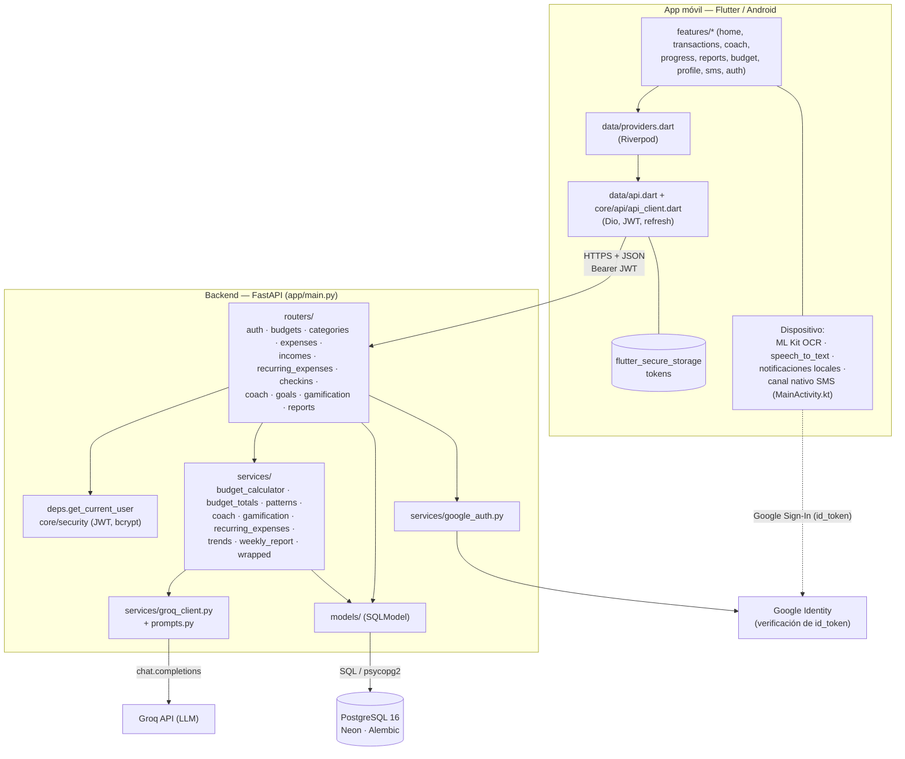

# Arquitectura

## Tech stack

| Capa | Tecnología |
|---|---|
| Backend | Python 3.12, FastAPI, SQLModel (SQLAlchemy), Alembic, Pydantic Settings, uvicorn |
| Auth | JWT (`python-jose`) access + refresh, `passlib[bcrypt]`, Google Sign-In (`google-auth`) |
| IA | SDK `groq`, modelo `openai/gpt-oss-20b` (constantes `MODEL` / `COACH_MODEL` en `services/groq_client.py`) |
| Base de datos | PostgreSQL 16 (`psycopg2-binary`); Neon en producción. SQLite en memoria en tests |
| Tooling backend | `uv`, `ruff`, `pytest` + `pytest-mock` |
| Móvil | Flutter (Dart ^3.13), Android únicamente |
| Estado / red móvil | `flutter_riverpod`, `dio`, `go_router`, `flutter_secure_storage`, `shared_preferences` |
| Capacidades del dispositivo | `google_mlkit_text_recognition` (OCR), `speech_to_text`, `image_picker`, `flutter_local_notifications`, `google_sign_in`, canal nativo Kotlin para SMS, `fl_chart`, `intl` + ARB (es/en) |
| Infra | Docker multi-stage (`backend/Dockerfile`), `docker-compose.yml` local, Render (`render.yaml`, plan free, región Ohio), GitHub Actions |

## Estilo y patrones

Cliente-servidor con **API REST stateless** y **monolito modular** en capas
(`routers → services → models`), organizado por dominio.

- **Routers** (`app/routers/*`): capa HTTP; validan con schemas Pydantic (`app/schemas/*`), resuelven la
  dependencia `get_current_user` (`app/deps.py`) y traducen errores de dominio a `HTTPException`.
- **Services** (`app/services/*`): reglas de negocio y acceso a Groq. Se prueban sin HTTP.
- **Models** (`app/models/*`): tablas SQLModel. Los schemas se mantienen separados (nunca se expone
  `hashed_password`).
- **Inyección de dependencias** con `Depends`: `get_session` (`app/db/session.py`) y `get_current_user`; los
  tests sustituyen la sesión por SQLite en memoria (`tests/conftest.py`).
- **Aislamiento por usuario**: cada consulta filtra por `user_id`/`owner_id`; un recurso ajeno responde 404.
- **Zona horaria por usuario**: `core/time.py::today_for(user)` define qué día es "hoy" (`User.zona_horaria`).
- **Manejo global de errores** en `app/main.py`: 422 con forma `{"error": "validation_error", "detail": [...]}` y
  500 genérico `{"error": "internal_server_error"}`.
- **Idempotencia por restricción única**: `PointEvent(user_id, clave)`, `Achievement(user_id, codigo)`,
  `Expense(recurring_expense_id, fecha)`.

En la app móvil: `features/*` (pantallas por dominio) → `data/providers.dart` (`FutureProvider`s de Riverpod)
→ `data/api.dart` (`Api`, un método por endpoint) → `core/api/api_client.dart` (Dio + `TokenStorage` +
renovación de token). Tras cualquier mutación `refreshData(ref)` invalida todos los providers dependientes.
La sesión (`data/session.dart`) gobierna las rutas de `go_router` (`/`, `/login`, `/register`, `/splash`).

## Diagrama 1 — Componentes



No hay colas de mensajes, cachés externas ni jobs programados. La única "caché" es `CoachMessage` con
`tipo="insights"` (consejos del día, JSON).

## Diagrama 2 — Flujo end-to-end: registrar un gasto por texto/voz/OCR/SMS

Caso crítico: del dato crudo al disponible por día actualizado y la reacción del coach.

```mermaid
sequenceDiagram
    actor U as Usuario
    participant App as App Flutter
    participant API as FastAPI (routers/expenses.py)
    participant G as groq_client
    participant LLM as Groq
    participant DB as PostgreSQL
    participant Co as services/coach.py

    U->>App: "almuerzo 18 mil ayer" (texto, voz, foto o SMS)
    Note over App: Voz → speech_to_text<br/>Foto → ML Kit OCR local<br/>SMS → canal nativo + filtro de monto
    App->>API: POST /expenses/parse {texto} (o /parse-receipt {texto_ocr})
    API->>DB: categorías por defecto + propias del usuario
    API->>G: parse_expense_text(texto, categorías, today_for(user))
    G->>LLM: prompt de extracción (JSON)
    LLM-->>G: respuesta
    G->>G: _extraer_json + _validar_gasto (monto, categoría válida, fecha)
    G-->>API: {tipo, monto, categoria, descripcion, fecha}
    API-->>App: borrador (NO se guarda)
    U->>App: confirma / edita
    App->>API: POST /expenses {category_id, monto, fecha, source, texto_original}
    API->>DB: find_budget_for_date + INSERT expenses
    API-->>App: 201 ExpenseResponse
    par En segundo plano (no bloquea el registro)
        App->>API: POST /coach/reaction {expense_id}
        API->>Co: reaccion_a_gasto (cifras de budget_totals)
        Co->>LLM: redacta mensaje
        Co->>Co: guardrails; si falla → texto de respaldo
        API-->>App: mensaje del coach
    and Refresco de datos
        App->>API: GET /budgets/active/summary
        API->>DB: SUM gastos / ingresos / aportes
        API-->>App: disponible_por_dia, en_riesgo, ...
        App->>API: GET /gamification/profile
        API->>DB: sync_gamification (retos, puntos, insignias)
    end
```

Pasos:

1. **Captura** en el dispositivo. El OCR y la voz ocurren en el teléfono; al backend solo llega texto.
2. **Parseo** (`/expenses/parse`, `/expenses/parse-receipt`): Groq devuelve JSON; `_validar_gasto` rechaza
   lo no interpretable (`ExpenseParseError` → 422; error de red/API → `GroqServiceError` → 502). El campo
   `tipo` distingue `gasto` de `ingreso`.
3. **Confirmación** humana y `POST /expenses`: se valida la categoría (`validate_category_access`) y que la fecha
   caiga en un presupuesto propio (`find_budget_for_date`, si no 400). `/expenses/from-text` hace parseo y
   guardado en un solo paso (rechaza ingresos).
4. **Reacción del coach** y **recálculo**: el resumen se calcula siempre desde cero con
   `budget_totals.summary_for` → `calculate_budget_summary`:
   `disponible_total = monto_total + ingresos − gastado − apartado`; `disponible_por_dia = disponible_total / días_restantes`.
   `en_riesgo` proyecta el agotamiento al ritmo real de gasto.
5. **Gamificación**: `sync_gamification` evalúa retos vencidos, otorga puntos idempotentes (`PointEvent.clave`) y
   desbloquea insignias al consultar `/challenges` o `/gamification/profile`.

### Flujo secundario: gasto fijo (recurrente)

`GET /recurring-expenses/pending` calcula vencimientos pendientes con `vencimiento_pendiente`; la app programa
una notificación local; `POST /{id}/pay` crea el `Expense` (`source="recurrente"`, único por `(recurring_expense_id, fecha)`)
o `POST /{id}/skip` fija `omitido_hasta`.

## Autenticación

- `POST /auth/register|login` (email + contraseña, correo normalizado a minúsculas) y `POST /auth/google`
  (verifica `id_token` contra `GOOGLE_CLIENT_ID`) emiten `access_token` (60 min) y `refresh_token` (30 días),
  ambos JWT firmados con `JWT_SECRET`; el campo `type` impide usar un refresh como access.
- Los tokens son stateless: un refresh emitido no se puede revocar.
- La app guarda los tokens en `flutter_secure_storage` y los renueva con `/auth/refresh`.
- `User` exige al menos un método de login (`ck_users_has_login_method`).
