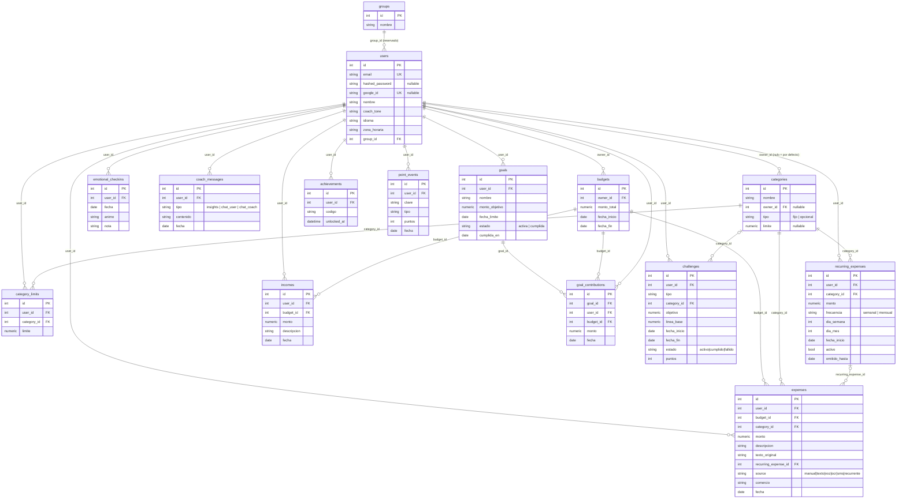

# Modelo de datos

Tablas definidas en `backend/app/models/*` (SQLModel) y versionadas con Alembic (`backend/alembic/versions/`,
9 migraciones desde `6a4686a52aeb_init`). Montos en `Numeric(12, 2)`.

## Diagrama 3 — Entidad-relación

## Reglas de integridad

| Tabla | Restricción |
|---|---|
| `users` | `email` y `google_id` únicos; `CHECK (hashed_password IS NOT NULL OR google_id IS NOT NULL)` |
| `categories` | `owner_id` nulo = categoría por defecto compartida (sembrada por `app/db/seed.py`: comida, transporte, entretenimiento, salud, servicios, otros); `CHECK tipo IN ('fijo','opcional')` |
| `category_limits` | `UNIQUE (user_id, category_id)`: el límite personal sobre una categoría compartida (`Category.limite` solo aplica a las propias) |
| `expenses` | `CHECK source IN (...)`; `UNIQUE (recurring_expense_id, fecha)` evita duplicar un gasto fijo |
| `emotional_checkins` | `UNIQUE (user_id, fecha)` (uno por día, reemplaza); `CHECK animo IN ('ansioso','preocupado','neutral','tranquilo','confiado')` |
| `challenges` | `CHECK tipo IN ('reducir_categoria','dias_sin_gasto','checkins','registro_diario','aportar_meta','semana_en_ritmo')`; `CHECK estado` |
| `achievements` | `UNIQUE (user_id, codigo)`; el catálogo de insignias vive en `services/gamification.py` |
| `point_events` | `UNIQUE (user_id, clave)`: libro de puntos idempotente |
| `goals` | `CHECK estado IN ('activa','cumplida')`; progreso = suma de `goal_contributions`, nunca auto-reportado |

## Notas

- `groups` y `users.group_id` están preparados para un modo familiar/grupal **no usado** en el MVP.
- Un `Expense`, `Income` o `GoalContribution` pertenece al `Budget` cuyo rango contiene su `fecha`
  (`services/budget_lookup.find_budget_for_date`); fuera de todo presupuesto la API responde 400.
- `GoalContribution` es dinero virtual: se descuenta del disponible del presupuesto (`apartado_total`).
- `DELETE /auth/me` borra la cuenta y todos sus datos en orden compatible con las llaves foráneas.
- Aplicar el esquema: `alembic upgrade head` (en producción lo hace `backend/start.sh`). Los tests usan
  `SQLModel.metadata.create_all` sobre SQLite.
