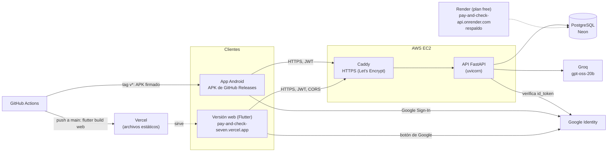

# Despliegue en producción

Cómo está montado Pay&Check en producción (actualizado el 21 nov 2026). Cuenta qué corre en
cada sitio, cómo se actualiza cada pieza y qué hay que tocar si algo cambia. **Aquí no hay secretos**: los
valores privados viven en las variables de entorno del servidor y en *Settings → Secrets and variables* de
GitHub.

## Mapa



| Pieza | Dónde | URL | Cómo se actualiza |
|---|---|---|---|
| API | AWS EC2, detrás de Caddy | `https://paycheck-swnt.duckdns.org` | Quien administra la instancia hace `git pull` de `main` y reinicia el servicio |
| API de respaldo | Render, plan free | `https://pay-and-check-api.onrender.com` | Despliegue automático de Render desde la rama configurada |
| Base de datos | Neon (PostgreSQL) | — | Migraciones de Alembic al arrancar la API (`backend/start.sh`) |
| App Android | GitHub Releases | [`…/releases/latest/download/pay-and-check.apk`](https://github.com/PAY-CHECK-SWNT/pay_and_check/releases/latest/download/pay-and-check.apk) | Tag `v*` → `mobile-release.yml` |
| Versión web | Vercel, proyecto `pay-and-check` | <https://pay-and-check-seven.vercel.app> | Push a `main` que toque `mobile/` → `web-deploy.yml` |

Versión publicada al 21 nov 2026: **v0.1.3** (APK y web desde `main` después de los PR #5, #6 y #7).

## Backend en AWS

- **Instancia EC2** con la API de `main`. Caddy termina HTTPS con un certificado automático para el dominio de
  DuckDNS y reenvía a uvicorn (la respuesta trae `via: 1.1 Caddy` y `server: uvicorn`).
- Las variables de entorno son las de [setup.md](setup.md#variables-de-entorno-backend). Las que importan para
  los clientes:
  - `CORS_ORIGINS` debe incluir `https://pay-and-check-seven.vercel.app` (y `http://localhost:5173` para probar
    la web en local). Sin el dominio de Vercel, el navegador bloquea todas las llamadas de la versión web.
  - `GOOGLE_CLIENT_ID` es el Client ID **web** de Google. Acepta varios separados por coma
    (`services/google_auth.py`).
- Tras cambiar una variable hay que **recrear** el proceso, no solo reiniciarlo, para que lea el archivo de
  nuevo (con Docker Compose: `docker compose up -d --force-recreate`).
- Comprobar CORS desde cualquier PC:

  ```bash
  curl -s -D - -o /dev/null -X OPTIONS https://paycheck-swnt.duckdns.org/auth/login \
    -H "Origin: https://pay-and-check-seven.vercel.app" -H "Access-Control-Request-Method: POST" \
    | grep -i access-control-allow-origin
  ```

> **Pendiente de documentar:** cómo se instaló la instancia (Docker o systemd, ruta del repo, archivo de
> variables, reglas del *security group*). Lo sabe quien la desplegó; conviene escribirlo aquí.

## Render (respaldo)

Sigue el camino original (`render.yaml`, ver [setup.md](setup.md#desplegar)). Ya no es el backend principal:

- **`keep-alive.yml` ahora llama a AWS**, porque usa la variable `API_BASE_URL`, que apunta a AWS. Render se
  duerme tras unos 15 minutos sin tráfico y la primera petición tarda cerca de un minuto.
- Para volver a Render: cambiar `API_BASE_URL` y `WEB_API_BASE_URL` en GitHub, publicar un tag nuevo (APK) y
  correr *Web deploy*. Además, Render necesita el dominio de Vercel en su `CORS_ORIGINS`.

## Versión web en Vercel

Para quien no tiene Android: usuarios de iPhone y de computador. Decisión y
límites en [ADR-010](decisiones/010-version-web-respaldo.md).

- Vercel no compila Flutter: `.github/workflows/web-deploy.yml` corre `flutter build web` en GitHub Actions y
  sube `mobile/build/web` con la CLI de Vercel (`vercel deploy --prod`).
- Configuración en GitHub: secreto `VERCEL_TOKEN` y variables `VERCEL_ORG_ID`, `VERCEL_PROJECT_ID`,
  `WEB_API_BASE_URL` (por defecto Render) y `GOOGLE_SERVER_CLIENT_ID`. Opcionalmente, `GOOGLE_WEB_CLIENT_ID`
  para usar en la web un cliente OAuth distinto del de Android.
- `mobile/web/vercel.json` reescribe toda ruta a `index.html` (SPA) y marca `index.html`,
  `flutter_bootstrap.js` y el *service worker* como `no-cache`, así una versión nueva se ve al recargar.
- Publicar a mano, desde un PC con la CLI de Vercel iniciada (`npx vercel login`):

  ```bash
  cd mobile
  flutter build web --release --dart-define=API_BASE_URL=https://paycheck-swnt.duckdns.org \
    --dart-define=GOOGLE_WEB_CLIENT_ID=<client id web>
  cd build/web && npx vercel link --yes --project pay-and-check && npx vercel deploy --prod --yes
  ```

- **iPhone:** Safari → Compartir → *Agregar a pantalla de inicio* la instala como PWA, a pantalla completa y con
  el ícono.

## App Android (APK)

- `git tag vX.Y.Z && git push origin vX.Y.Z` dispara `mobile-release.yml`: compila el APK firmado
  (`android-arm` y `android-arm64`, unos 79 MB) contra `API_BASE_URL` y lo adjunta al Release. Se publica también
  como `pay-and-check.apk`, y por eso el enlace `…/releases/latest/download/pay-and-check.apk` siempre baja la
  última versión (es el del QR).
- La firma usa el keystore guardado en los secretos `ANDROID_KEYSTORE_*`. **Su SHA-1 es el que tiene registrado
  Google** (ver abajo): si se cambia el keystore, el login con Google deja de funcionar hasta registrar el nuevo.
- Instalar encima de un APK firmado con otra llave (uno de depuración, por ejemplo) falla: hay que desinstalar
  primero. Los datos están en el servidor y no se pierden.

## Google Sign-In

Proyecto de Google Cloud con número `360030321900`. Hacen falta dos credenciales OAuth del **mismo** proyecto:

| Credencial | Para qué | Configuración |
|---|---|---|
| Cliente **web** (`360030321900-0srru8ea…`) | Lo usan el backend (`GOOGLE_CLIENT_ID`), la app Android (`serverClientId`) y la versión web | *Orígenes autorizados de JavaScript*: `https://pay-and-check-seven.vercel.app` y `http://localhost:5173` |
| Cliente **Android** | Que Google reconozca el APK | Paquete `com.diegochavarro.pay_and_check`, SHA-1 `16:10:65:C6:FF:58:32:11:1B:64:F9:50:45:8A:5D:82:CA:6C:AC:0C` (keystore de los releases) |

- Sin el cliente Android, el selector de cuentas se abre pero la app vuelve al login. `adb logcat` muestra
  *"This android application is not registered to use OAuth2.0"*. Ver el SHA-1 de un APK:
  `$ANDROID_HOME/build-tools/36.0.0/apksigner verify --print-certs app.apk`.
- Un APK de depuración (`flutter run`) se firma con otra llave: para probar Google así hay que registrar también
  esa huella en otro cliente Android.
- **Pantalla de consentimiento:** debe estar *En producción*. En *Prueba* solo pueden entrar los correos de la
  lista de usuarios de prueba.
- Existe un segundo cliente web (`360030321900-iauvmenob…`) que no se usa.

## Verificación después de desplegar

1. `curl https://paycheck-swnt.duckdns.org/health` responde `{"status":"ok"}`.
2. La web abre y entra con correo y con Google (recargar con Ctrl+Shift+R si se ve la versión anterior).
3. El APK instalado es el del último Release (Perfil no lo muestra; comparar con la fecha de instalación).
4. Si se usa Render, despertarlo antes de usarlo (`/health`); tarda cerca de un minuto.
