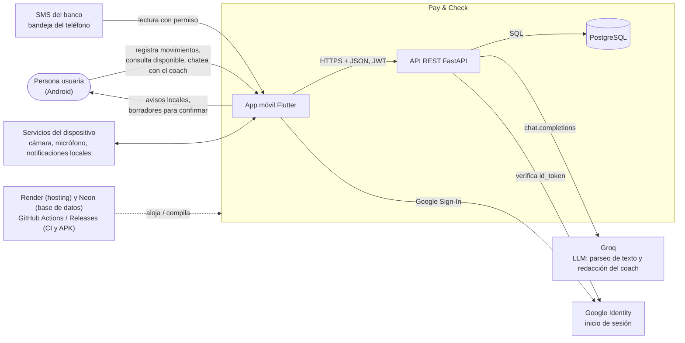
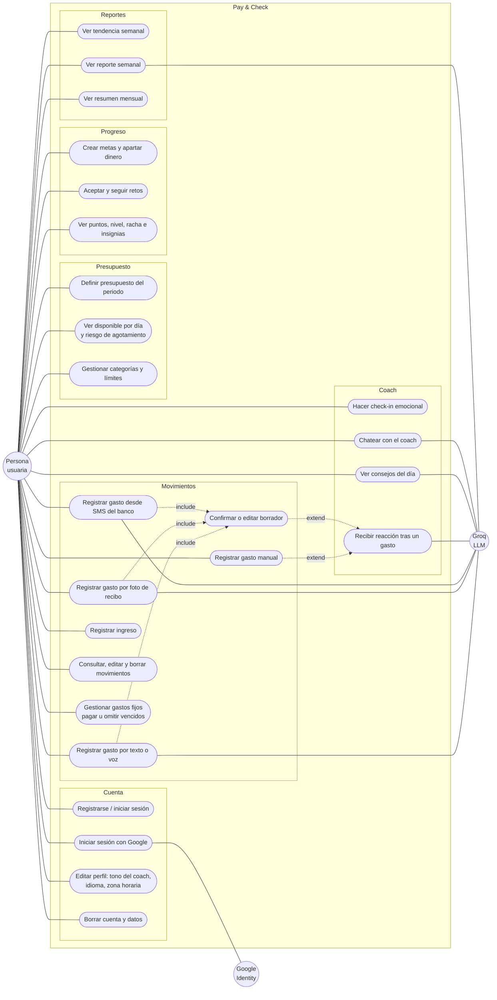

# Casos de uso y contexto

Mermaid no tiene un tipo nativo de diagrama de casos de uso UML; se modela con `flowchart` (actores como
círculos, casos de uso como óvalos, frontera del sistema como `subgraph`).

## Diagrama de contexto general

Qué es el sistema, quién lo usa y con qué sistemas externos habla.

Límites del sistema: no se conecta a bancos (los aportes a metas son dinero virtual), no tiene servidor de push
(las notificaciones son locales) y la IA nunca calcula cifras.

## Diagrama de casos de uso

Actores: **Persona usuaria** (principal), **Groq** y **Google Identity** (sistemas secundarios).

## Trazabilidad

| Casos de uso | Endpoints (ver [api.md](api.md)) |
|---|---|
| UC1–UC4 | `/auth/register`, `/auth/login`, `/auth/google`, `/auth/refresh`, `/auth/me` |
| UC5–UC7 | `/budgets`, `/budgets/active/summary`, `/categories` |
| UC8, UC14 | `/expenses`, `/expenses/{id}` |
| UC9, UC10, UC11, UC13 | `/expenses/parse`, `/expenses/parse-receipt`, luego `POST /expenses` (SMS con `source="sms"`) |
| UC12 | `/incomes` (la IA distingue ingresos con `tipo="ingreso"` en `/expenses/parse`) |
| UC15 | `/recurring-expenses`, `/pending`, `/{id}/pay`, `/{id}/skip` |
| UC16–UC19 | `/checkins`, `/coach/reaction`, `/coach/insights`, `/coach/chat` |
| UC20–UC22 | `/goals`, `/challenges`, `/gamification/profile` |
| UC23–UC25 | `/reports/trends`, `/reports/weekly`, `/reports/monthly-wrapped` |

Cuando Groq falla o no hay `GROQ_API_KEY`: el parseo (UC9–UC11) responde 502 y se usa el formulario manual; el
coach y el reporte semanal usan textos de respaldo deterministas.
