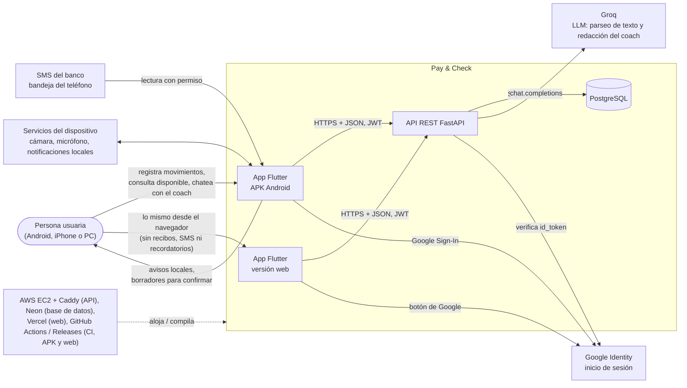
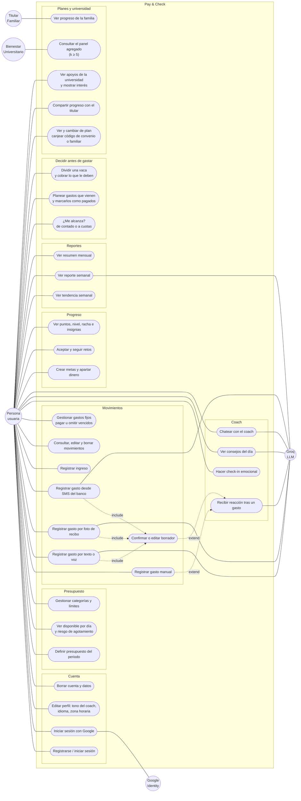

# Casos de uso y contexto

Mermaid no tiene un tipo nativo de diagrama de casos de uso UML; se modela con `flowchart` (actores como
círculos, casos de uso como óvalos, frontera del sistema como `subgraph`).

## Diagrama de contexto general

Qué es el sistema, quién lo usa y con qué sistemas externos habla.

Límites del sistema: la versión web no lee SMS ni notificaciones, no reconoce recibos y no programa
recordatorios ([ADR-010](decisiones/010-version-web-respaldo.md)); no se conecta a bancos (los aportes a metas son dinero virtual), no tiene servidor de push
(las notificaciones son locales) y la IA nunca calcula cifras.

## Diagrama de casos de uso

Actores: **Persona usuaria** (principal), **Titular del plan Familiar** y **Bienestar Universitario**
(secundarios humanos), **Groq** y **Google Identity** (sistemas).

## Trazabilidad

| Casos de uso | Endpoints (ver [api.md](api.md)) |
|---|---|
| UC1–UC4 | `/auth/register`, `/auth/login`, `/auth/google`, `/auth/refresh`, `/auth/me` |
| UC5–UC7 | `/budgets`, `/budgets/active/summary`, `/categories` |
| UC8, UC14 | `/expenses`, `/expenses/{id}` |
| UC9, UC10, UC11, UC13 | `/expenses/parse`, `/expenses/parse-receipt`, luego `POST /expenses` (SMS con `source="sms"`) |
| UC12 | `/incomes` (la IA distingue ingresos con `tipo="ingreso"` en `/expenses/parse`) |
| UC15 | `/recurring-expenses`, `/pending`, `/{id}/pay`, `/{id}/skip` |
| UC16–UC19 | `/checkins`, `/coach/reaction`, `/coach/insights`, `/coach/chat` |
| UC20–UC22 | `/goals`, `/challenges`, `/gamification/profile` |
| UC23–UC25 | `/reports/trends`, `/reports/weekly`, `/reports/monthly-wrapped`, `/reports/repeated` |
| UC26 | `/budgets/active/simulate`, `/budgets/simulate-credit` |
| UC27 | `/planned-expenses`, `/planned-expenses/{id}/done` (solo marca; no crea gasto) |
| UC28 | `/expenses/split`, `/receivables`, `/receivables/{id}/paid` |
| UC29–UC31 | `/plans`, `/me/subscription`, `/me/subscription/redeem`, `/me/subscription/share-progress`, `/me/family/progress` |
| UC32 | `/support`, `/support/{id}/interest` |
| UC33 | `/panel/{org_id}` (HTML con token de la universidad) |

En la versión web no están UC10, UC11 ni los recordatorios de UC15 (el resto de UC15 sí: la lista de gastos
fijos por pagar).

Cuando Groq falla o no hay `GROQ_API_KEY`: el parseo (UC9–UC11) responde 503 y se usa el formulario manual; el
coach y el reporte semanal usan textos de respaldo deterministas.
